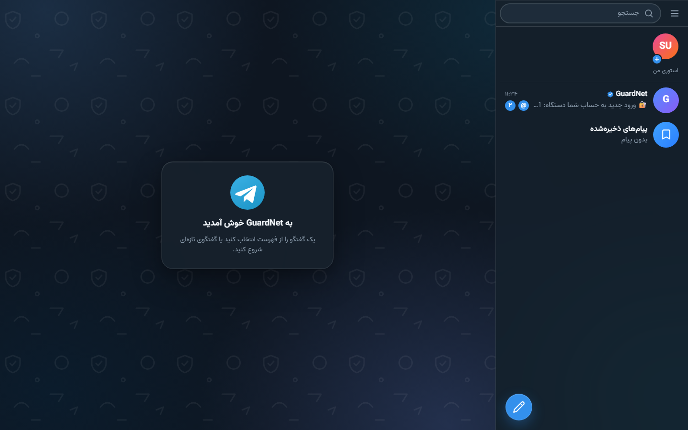
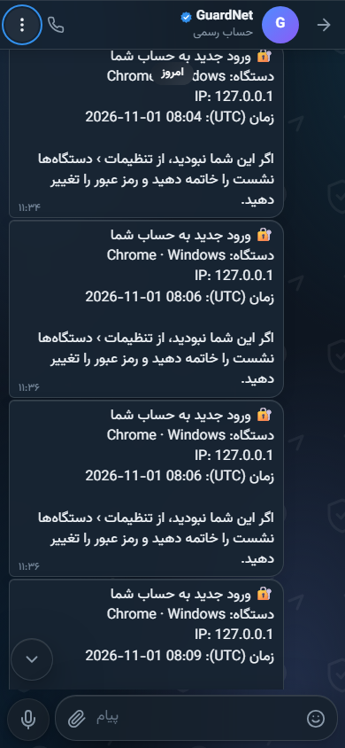
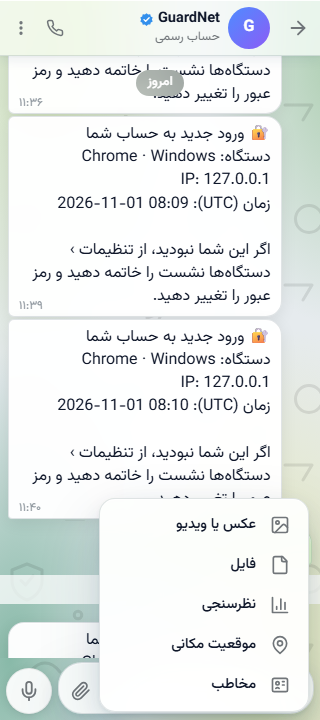
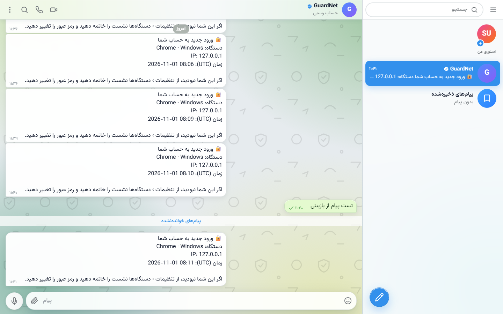
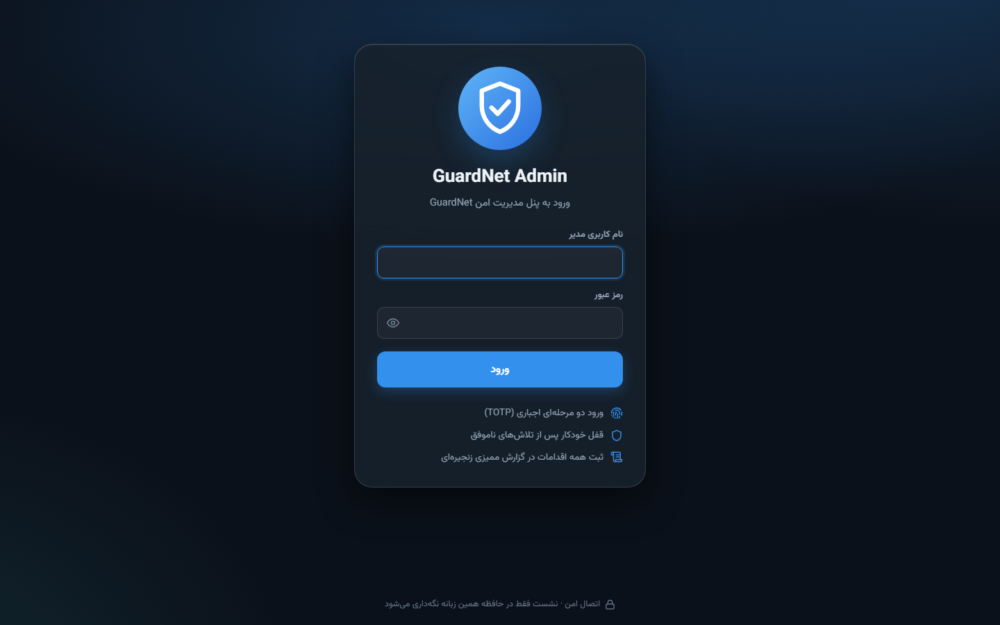

<div align="center">


<br>

**پیام‌رسان امن و کاملاً خودمیزبان**
<br>
REST + WebSocket + WebRTC روی Node.js و SQLite — با یک جفت‌شدن ساده روی یک سرور.

<br>


</div>

---

## GuardNet چیست؟

یک پیام‌رسان کامل و مستقل برای تیم یا سازمانی که نمی‌خواهد پیام‌هایش از سرورِ کسی دیگر رد شود. همه‌چیز روی سرور خودتان است: پایگاه داده، فایل‌ها، تماس‌ها و پنل مدیریت. هیچ سرویس بیرونی، هیچ حساب ابری، هیچ تحلیلی که بیرون برود.

سه رابط کاربری از یک بک‌اند واحد:

| | آدرس | توضیح |
| --- | --- | --- |
| **وب‌اپ** | `/` | پیام‌رسان کامل، RTL، پنج تم، واکنش‌گرا از ۲۸۰px تا ۴K |
| **پنل مدیریت** | `/admin` | کاربران، گزارش‌ها، امنیت، ممیزی، تنظیمات سیستم |
| **کلاینت‌ها** | — | اندروید (API 21+) و دسکتاپ ویندوز (7 SP1 تا 11، ۳۲ و ۶۴ بیت) |

<br>

<div align="center">

</div>

<br>

## قابلیت‌ها

<table>
<tr>
<td width="50%" valign="top">

**گفتگو**

- پیام خصوصی، گروه، کانال و پیام‌های ذخیره‌شده
- رسانه: تصویر، ویدیو، فایل، ویس با موج صوتی، استیکر، GIF
- نظرسنجی، موقعیت مکانی، کارت مخاطب
- پاسخ، ویرایش (تا ۴۸ ساعت)، بازارسال، سین، حذف برای همه
- پیام زمان‌بندی‌شده و خودتخریب
- واکنش ایموجی، تیک خوانده‌شده، شمارنده خوانده‌نشده
- جستجوی درون‌گفتگو و جستجوی سراسری
- پوشه‌بندی گفتگوها، آرشیو، سنجاق

</td>
<td width="50%" valign="top">

**تماس و محتوا**

- تماس صوتی و تصویری WebRTC با اشتراک صفحه
- سرور coturn خودمیزبان با اعتبار موقت (HMAC)
- استوری ۲۴/۷۲ ساعته با نمایشگر
- چت رسمی GuardNet و دستیار بات
- مخاطبین، مسدودسازی، گزارش تخلف
- پریمیوم: سهمیه بالاتر، استیکر ویژه، پوشه بیشتر

</td>
</tr>
<tr>
<td width="50%" valign="top">

**امنیت**

- scrypt (N=2¹⁵) برای رمزها
- AES-256-GCM برای رازهای TOTP و توکن‌های حساس
- نشست‌ها فقط به‌صورت HMAC-SHA256 ذخیره می‌شوند
- ورود با QR از دستگاه دیگر
- قفل اپ با کد عددی (خارج از حافظه ذخیره نمی‌شود)
- محدودیت نرخ، بلاک IP، هدرهای امنیتی
- اعتبارسنجی کامل ورودی‌ها در سمت سرور

</td>
<td width="50%" valign="top">

**تجربه کاربری**

- پنج تم: `dark` `light` `midnight` `aurora` `gold`
- تمام‌صفحه از ۲۸۰px موبایل تا دسکتاپ عریض
- RTL بومی، فونت وزیرمتن، افکت شیشه‌ای
- میان‌بر‌های صفحه‌کلید، منوهای زمینه
- بدون هیچ وابستگی به CDN یا سرویس بیرونی

</td>
</tr>
</table>

<br>

<div align="center">
&nbsp;
&nbsp;

</div>

---

## شروع سریع

**پیش‌نیاز:** Node.js ≥ ۱۸.۱۷ و یک پوشه برای داده‌ها.

```bash
git clone https://github.com/localvps/guardnet.git
cd guardnet
```

**۱) نصب وابستگی‌ها**

```bash
cd backend && npm install && cd ..
cd frontend && npm install && cd ..
cd admin && npm install && cd ..
```

**۲) بیلد فرانت‌اند و پنل**

```bash
cd frontend && npm run build && cd ..
cd admin && npm run build && cd ..
```

**۳) اجرا**

```bash
cd backend && npm start
```

حالا روی `http://localhost:8000` بالا می‌آید — وب‌اپ روی `/` و پنل مدیریت روی `/admin`.

> در اولین اجرا، حساب مدیر ارشد با رمز تصادفی ساخته می‌شود و در `backend/data/INITIAL_ADMIN.txt` نوشته می‌شود (دسترسی فقط برای مالک فایل). اولین ورود شما را مجبور می‌کند رمز را عوض کنید و TOTP را فعال کنید — **بعد از آن این فایل را پاک کنید.**

### حالت توسعه (hot reload)

سه ترمینال جدا:

```bash
cd backend && npm run dev        # :8000
```

```bash
cd frontend && npm run dev       # :5173
```

```bash
cd admin && npm run dev          # :5174
```

---

## ساختار مخزن

```
guardnet/
├── backend/            سرور Node.js — REST + WebSocket + SQLite
│   ├── src/routes/     احراز هویت، گفتگوها، پیام‌ها، رسانه، استوری، تماس
│   ├── src/realtime/   hub کاربران، adminHub، حضور آنلاین، سیگنال‌دهی WebRTC
│   ├── src/admin/      API پنل مدیریت، نشست‌ها، ممیزی زنجیره‌ای SHA-256
│   ├── src/lib/        امنیت (scrypt، AES-GCM، TOTP)، تنظیمات، HTTP
│   └── src/cli/        ابزار ساخت مدیر از خط فرمان
├── frontend/           وب‌اپ پیام‌رسان — React 18 + Vite 5
├── admin/              پنل مدیریت — React 18 + Vite 5 (بیلد جدا)
├── android/            کلاینت اندروید (WebView، API 21+)
├── desktop/            کلاینت ویندوز — Electron 21 + electron-builder
├── deploy/coturn/      پیکربندی TURN خودمیزبان با Docker
└── ecosystem.config.cjs  تعریف فرآیند production با PM2
```

---

## تنظیمات محیطی

| متغیر | پیش‌فرض | توضیح |
| --- | --- | --- |
| `PORT` | `8000` | پورت سرور |
| `HOST` | `0.0.0.0` | آدرس bind |
| `GUARDNET_DATA_DIR` | `backend/data` | پایگاه داده و فایل‌های آپلود |
| `GUARDNET_MASTER_KEY` | ساخته می‌شود | کلید اصلی رمزنگاری (۶۴ نویسه hex). اگر تنظیم نشود، در پوشه داده ساخته و نگه‌داری می‌شود |
| `TRUST_PROXY` | `1` | با `0` هدر `X-Forwarded-For` کاملاً نادیده گرفته می‌شود — **اگر پشت reverse proxy نیستید روی `0` بگذارید** |
| `FRONTEND_DIST` | `frontend/dist` | مسیر بیلد وب‌اپ |
| `ADMIN_DIST` | `admin/dist` | مسیر بیلد پنل مدیریت |
| `WEBRTC_STUN_URLS` | — | فهرست STUN جداشده با کاما |
| `WEBRTC_TURN_URLS` | — | فهرست TURN جداشده با کاما |
| `WEBRTC_TURN_USER` + `WEBRTC_TURN_SECRET_FILE` | — | اعتبار TURN؛ راز از فایل خوانده می‌شود، نه از متغیر |
| `WEBRTC_FORCE_TURN` | `0` | اجبار همه تماس‌ها به عبور از TURN |

---

## امنیت

چه چیزی پیاده شده و چطور کار می‌کند:

| لایه | جزئیات |
| --- | --- |
| رمز عبور | `scrypt` با N=2¹⁵، salt تصادفی، مقایسه زمان‌ثابت |
| رازهای حساس | TOTP و توکن‌های «مرا به خاطر بسپار» با AES-256-GCM (`v1.<iv>.<tag>.<ct>`) |
| نشست | توکن ۲۵۶ بیتی تصادفی؛ سرور فقط HMAC-SHA256 آن را می‌داند. توکن در `localStorage` مرورگر می‌ماند، نه دیتابیس |
| نشست ادمین | فقط در حافظه تب؛ با بستن تب revoke می‌شود. مقید به User-Agent |
| ورود دومرحله‌ای ادمین | TOTP مطابق RFC 6238 با پنجره ±۱ گام + ۱۰ کد بازیابی یک‌بارمصرف |
| ماشین حالت ادمین | `password` → `enroll` → `totp` → `full`، با اجبار تغییر رمز در اولین ورود |
| Step-up | عملیات حساس نیاز به تأیید دوباره هویت (TTL = ۵ دقیقه) دارند |
| نقش‌ها | `viewer` (فقط خواندن)، `moderator` (مدیریت محتوا)، `superadmin` (همه‌چیز) |
| ممیزی | هر عمل ادمین با زنجیره هش SHA-256 ثبت می‌شود — دستکاری هر رکورد، همه رکوردهای بعدی را نامعتبر می‌کند |
| شبکه | rate limit، بلاک‌لیست IP، CIDR allowlist ادمین، CSP، HSTS، `X-Frame-Options: DENY` |
| داده | همه ورودی‌ها در سمت سرور اعتبارسنجی می‌شوند؛ SQL پارامتری؛ هیچ `innerHTML` روی داده کاربر |

### نکته‌های استقرار

- اگر پشت nginx/Caddy نیستید `TRUST_PROXY=0` بگذارید، وگرنه کلاینت می‌تواند `X-Forwarded-For` جعل کند.
- `GUARDNET_DATA_DIR` را با دسترسی `0700` نگه دارید و از آن نسخه پشتیبان بگیرید. کلید اصلی رمزنگاری همان‌جا است؛ بدون آن رازهای TOTP قابل بازیابی نیستند.
- برای HTTPS از reverse proxy استفاده کنید. HSTS فقط روی درخواست‌های واقعاً HTTPS ست می‌شود.

---

## تماس‌های WebRTC

به‌صورت پیش‌فرض با STUN کار می‌کند. برای شبکه‌های سخت (NAT متقارن، فایروال سازمانی) یک TURN خودمیزبان بگذارید — راهنمای کامل و فایل پیکربندی در [`deploy/coturn/`](deploy/coturn/README.md).

```bash
cd deploy/coturn && docker compose up -d
```

اعتبار TURN به‌صورت موقت (HMAC + TTL) به کلاینت داده می‌شود، نه ثابت — پس با هر تماس عوض می‌شود.

---

## پنل مدیریت

دسترسی روی `/admin`. پنل **جدا** از اپ است: باندل مستقل، نشست مستقل، و ورود دومرحله‌ای اجباری.

<table>
<tr>
<td valign="top">

**داشبورد و پایش**

- آمار زنده کاربران، گفتگوها، پیام‌ها
- نمودار فعالیت و گزارش تخلفات
- مشاهده پیام‌های گزارش‌شده و رسیدگی

</td>
<td valign="top">

**مدیریت**

- کاربران: بن، آنبن، تأیید، پریمیوم، بازنشانی رمز، خروج اجباری
- گفتگوها: فریز، حذف پیام، مدیریت اعضا
- رسانه‌ها و جستجوی پیام
- پیام همگانی

</td>
<td valign="top">

**امنیت و تنظیمات**

- تنظیمات امنیتی زنده (طول رمز، قفل، عمر نشست)
- IP allowlist، بلاک‌لیست، تلاش‌های ورود
- گزارش ممیزی با تأیید زنجیره
- مدیران: افزودن، بازنشانی، تغییر نقش
- حالت نگهداری، سقف آپلود، نرخ پیام

</td>
</tr>
</table>

<br>

<div align="center">

</div>

---

## انواع پیام

`text` · `image` · `video` · `file` · `voice` · `sticker` · `gif` · `poll` · `location` · `contact`

---

## همه‌چیز خودمیزبان

GuardNet هیچ درخواست خودکاری به بیرون نمی‌فرستد — نه Google Fonts، نه CDN، نه سرویس نقشه، نه analytics. فونت، آیکون‌ها، استیکرها و GIFها همه در باندل هستند و پیش‌نمایش موقعیت مکانی با CSS ساخته می‌شود (فقط اگر کاربر روی آن بزند به openstreetmap.org می‌رود). روی شبکه‌ای که به اینترنت آزاد دسترسی ندارد هم کامل کار می‌کند.

---

## نکته‌های نگه‌داری

- پایگاه داده SQLite در حالت WAL است. فایل `guardnet.db` را همراه `guardnet.db-wal` و `guardnet.db-shm` پشتیبان بگیرید، یا بهتر: از خودِ پوشه داده.
- پنل مدیریت تغییرات حساس را در ممیزی ثبت می‌کند؛ صفحه **Audit → تأیید زنجیره** را دوره‌ای بزنید.
- `npm run create-admin -- <username>` یک مدیر جدید از خط فرمان می‌سازد.

---

<div align="center">
<sub><b>GuardNet</b> — ساخته‌شده برای اینکه پیام‌هایت پیش خودت بمانند.</sub>
</div>
